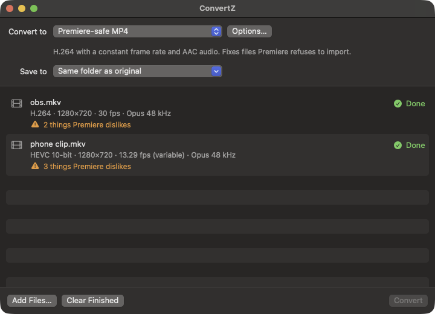

# ConvertZ

A friendly Mac app for converting video and audio files. Drop files in, pick a format, press Convert.

It exists mostly for one job: **fixing files that Adobe Premiere Pro refuses to import** (or imports with drifting
audio), without having to remember ffmpeg flags.



## What it does

- Tells you, per file, what Premiere is likely to object to: variable frame rate, MKV/WebM containers, Opus audio,
  10-bit H.264, AV1/VP9, odd dimensions and so on.
- **Premiere-safe MP4** (the default) re-encodes to H.264, 8-bit 4:2:0, constant frame rate, AAC 48 kHz.
- **Keeps as much quality as it can.** Video or audio that is already fine is copied untouched rather than
  re-encoded: an OBS recording in MKV, for example, becomes an MP4 with bit-for-bit the same picture. Only the
  parts that are the problem get converted, and those at visually lossless settings by default. If a copy turns
  out not to work, the file is re-encoded automatically.
- Converts a whole queue, with progress, time remaining and cancel.
- Never overwrites or deletes your original. Unfinished files are removed, never left looking complete.
- Checks every converted file by reading it back before calling it done.
- Needs nothing else installed: ffmpeg is inside the app.

| Format | What you get |
|---|---|
| Premiere-safe MP4 | H.264, constant frame rate, AAC. Options: quality, hardware encoder, resolution, frame rate. 8-bit: for 10-bit or HDR footage use ProRes, which keeps the extra depth |
| ProRes MOV | ProRes Proxy / LT / 422 / HQ with uncompressed audio, for smooth editing |
| Rewrap to MP4 | Same video and audio moved into an MP4, instantly and without quality loss |
| H.265 MP4 | Small files for sharing |
| WebM, GIF | For the web |
| MP3, WAV, M4A, FLAC | Audio, including the audio track of a video. WAV keeps the source's bit depth and sample rate; MP3 and AAC sources are not compressed twice |

## Install

Requires an Apple Silicon Mac running macOS 14 or later.

```sh
brew tap doronz88/tap
brew trust --cask doronz88/tap/convertz   # recent Homebrew requires trusting third-party casks
brew install --cask doronz88/tap/convertz
```

Or download `ConvertZ-x.y.z.zip` from the [latest release](https://github.com/doronz88/ConvertZ/releases/latest),
unzip it and drag ConvertZ to Applications.

> ConvertZ is ad-hoc signed, not notarized. The Homebrew cask clears the quarantine flag for you. If you downloaded
> the zip instead, macOS will refuse to open it until you run:
> `xattr -dr com.apple.quarantine /Applications/ConvertZ.app`

## Building

```sh
swift test      # uses Homebrew's ffmpeg if present; otherwise the ffmpeg tests are skipped
./build.sh      # downloads the pinned ffmpeg and builds build/ConvertZ.app
```

Pushing a `v*` tag runs the release workflow: it tests, builds, publishes the zip as a GitHub release and, if the
`TAP_DEPLOY_KEY` secret is set (a write deploy key on the tap), bumps the cask in
[doronz88/homebrew-tap](https://github.com/doronz88/homebrew-tap).

## License

ConvertZ is MIT licensed. The app bundle also includes [FFmpeg](https://ffmpeg.org), a separate program under the
GNU GPL v3 that ConvertZ runs to do the conversions; see [THIRD-PARTY.md](THIRD-PARTY.md).
